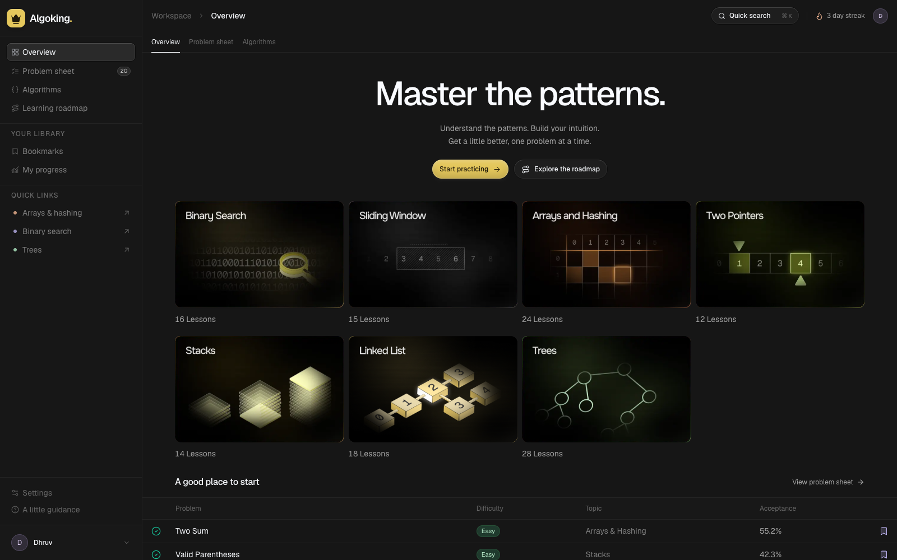

<div align="center">

# Algoking

**A little practice. A lot of progress.**

A minimal workspace for learning data structures and algorithms, recognizing patterns, and building a consistent practice habit.


[Features](#features) · [Getting started](#getting-started) · [Project structure](#project-structure) · [Contributing](#contributing)

</div>

## Landing page



The overview brings learning patterns, a visual roadmap, and practice problems into one focused dashboard, with responsive navigation and locally bundled Geist typography.

## Features

- **Pattern-based learning** — explore Arrays & Hashing, Two Pointers, Stacks, Binary Search, Sliding Window, Linked Lists, Trees, and Graphs.
- **Searchable problem sheet** — browse published lessons, search by title or topic, and filter by difficulty.
- **Interactive tutorials** — study challenges and examples, inspect computed walkthrough steps, and copy syntax-highlighted Python/C++ solutions.
- **Stack algorithms** — 20 interactive lessons cover stack foundations, expression parsing, monotonic stacks, histogram and matrix rectangles, rainwater, subarray minima, collisions, and greedy digit removal. Open `/algorithms/stacks`; each lesson includes two computed examples and Python/C++17 code.
- **Binary search algorithms** — 20 interactive lessons cover exact search, lower/upper bounds, duplicate ranges, rotated arrays, peaks, integer roots, matrices, answer-space search, and median/kth partitions. Open `/algorithms/binary-search` for computed examples, invariants, edge cases, and Python/C++17 solutions.
- **Graph algorithms** — 15 lessons cover DFS, BFS, Dijkstra, Kahn, Bellman–Ford, Floyd–Warshall, Prim, Kruskal, Union-Find, bipartite checking, directed cycle detection, Kosaraju, Tarjan SCC, bridges, and articulation points.
- **Visual learning roadmap** — follow connected topics and choose what to practice next.
- **Bookmarks and progress** — save problems, mark them solved, and revisit progress derived from published lessons.
- **Quick search** — open the search dialog with `⌘ K` on macOS or `Ctrl K` on Windows/Linux.

### Preview scope

Algoking is a frontend study app with published problems in [`lib/data.ts`](lib/data.ts). The 20-lesson Binary Search collection and 15 graph algorithms have interactive walkthroughs and syntax-highlighted Python/C++ solutions. Open `/algorithms/graphs` for the graph collection, grouped by traversal, shortest paths, ordering, spanning trees, and connectivity. Every graph lesson includes two examples, with relevant failure or disconnected cases. Previous sample problems and acceptance rates have been removed. Landing-page lesson totals and streak indicators remain illustrative.

Bookmarks and solved overrides persist in the current browser's local storage. There is no backend, authentication, cross-device synchronization, or built-in code execution. Settings are session-only preview controls.

## Getting started

### Requirements

- Node.js **20.9 or later**
- npm

### Run locally

```bash
git clone https://github.com/dhruv-colosus/algoking.git
cd algoking
npm ci
npm run dev
```

Open [http://localhost:3000](http://localhost:3000). The current preview requires no environment variables, API keys, or database setup.

### Production build

```bash
npm run build
npm run start
```

The build script explicitly uses Webpack. Fonts are bundled in `public/fonts`, so the build does not need to download them.

## Development commands

| Command | Purpose |
| --- | --- |
| `npm run dev` | Start the Next.js development server. |
| `npm run build` | Create a production build with Webpack. |
| `npm run start` | Serve the completed production build. |
| `npm run lint` | Run ESLint across the project. |
| `npm run typecheck` | Check TypeScript without emitting files. |
| `npm run test:binary-search` | Verify all 20 binary search lessons, randomized traces, and executable Python/C++17 solutions. |
| `npm run test:graphs` | Verify graph traces and compare randomized results with independent checks. |

The binary search correctness suite requires `python3` and a C++17 compiler. Use `CXX` to select a compiler and `SDKROOT` to select a compatible macOS SDK if the installed Xcode and Command Line Tools versions differ.

## Routes

| Route | View |
| --- | --- |
| `/` | Landing page and featured practice problems |
| `/problems` | Searchable problem sheet with difficulty filters |
| `/problems/[slug]` | Interactive tutorials, Python/C++ solutions, complexity, and practice actions |
| `/algorithms` | Algorithm and pattern overview |
| `/algorithms/[slug]` | Pattern details and related problems |
| `/algorithms/binary-search` | Binary search collection with 20 interactive lessons |
| `/algorithms/graphs` | Graph algorithm collection with 15 published lessons |
| `/topics/[slug]` | Alternate entry point for pattern details |
| `/roadmap` | Visual learning roadmap |
| `/bookmarks` | Saved problems |
| `/progress` | Progress overview based on published lessons and local solved state |
| `/settings` | Preview practice preferences |

## Project structure

```text
app/                       App Router pages, shared layout, and styles
components/
  home/                    Illustrated topic cards
  layout/                  Shared navigation and application shell
  problems/                Problem lists, actions, and local state
  tutorials/               Interactive walkthroughs and server-highlighted code
  ui/                      Reusable UI primitives
lib/                       Published lessons, graph algorithms/traces, and utilities
scripts/                   Graph correctness checks
public/                    Fonts, topic illustrations, and roadmap assets
docs/                      Design documentation and preview images
skills/algoking-design/    Project-local design guidance
```

The stack combines Next.js App Router, React, TypeScript, and Tailwind CSS, with Lucide icons and shared component variants. Shell and home styles live in `app/globals.css`; secondary study-page layouts live in `app/secondary.css`.

## Design documentation

The visual system adapts the compact dark dashboard styling and selected UI primitives from [kargulstudio/sales-crm](https://github.com/kargulstudio/sales-crm) for a DSA study product.

- [Design tokens and layout guidance](docs/design-system.md)
- [Shared component contracts](docs/components.md)
- [Reference and adaptation record](docs/reference.md)
- [Project-local design skill](skills/algoking-design/SKILL.md)

## Contributing

Read [`AGENTS.md`](AGENTS.md) before making changes. For frontend work, follow the local design skill and linked component documentation to preserve the shared shell and existing styling. When using an AI coding agent, consult the installed Next.js guides in `node_modules/next/dist/docs/` for version-specific conventions.

Before submitting compiled code changes, run:

```bash
npm run build
npm run lint
npm run typecheck
```

Check meaningful UI changes at desktop and mobile widths, including keyboard navigation and visible focus states. Include a concise explanation of the change and relevant screenshots in your pull request.

## Tags

`dsa` · `data-structures` · `algorithms` · `coding-practice` · `interview-preparation` · `learning-platform` · `nextjs` · `react` · `typescript` · `tailwindcss`
